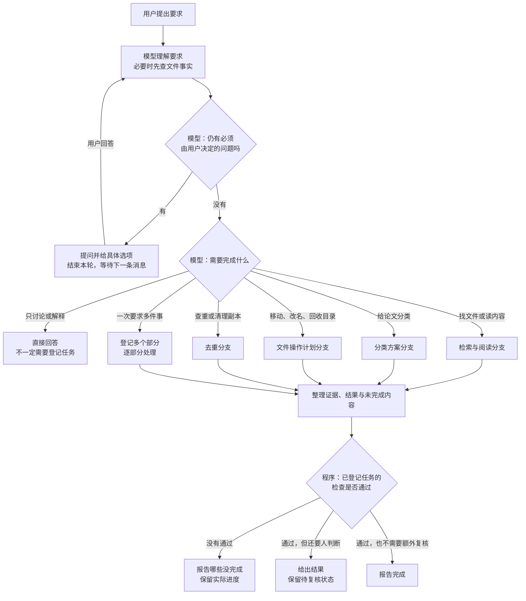
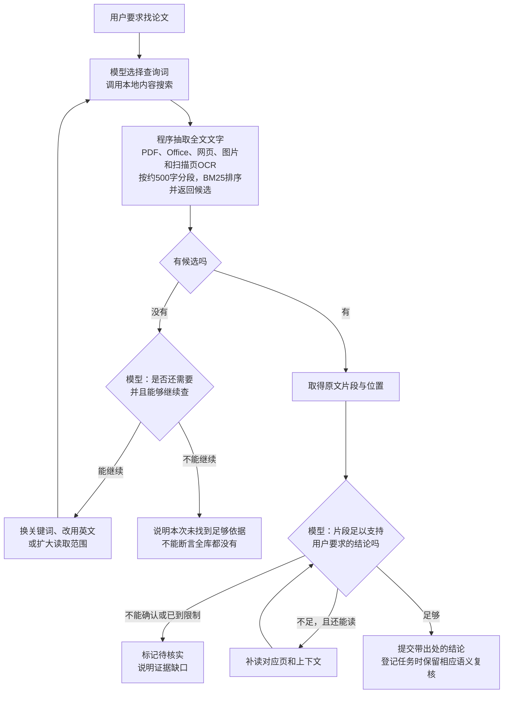
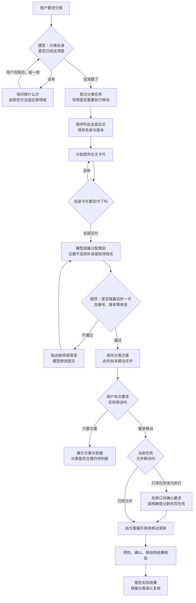
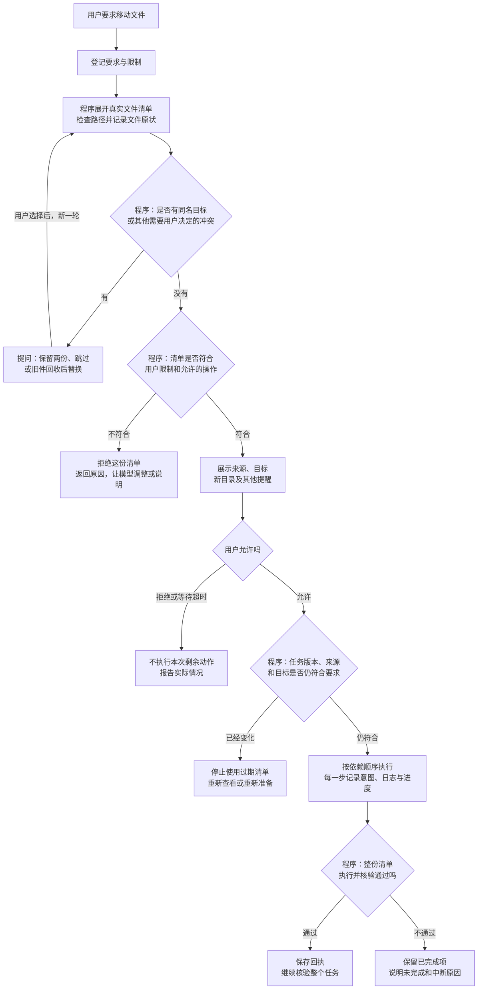
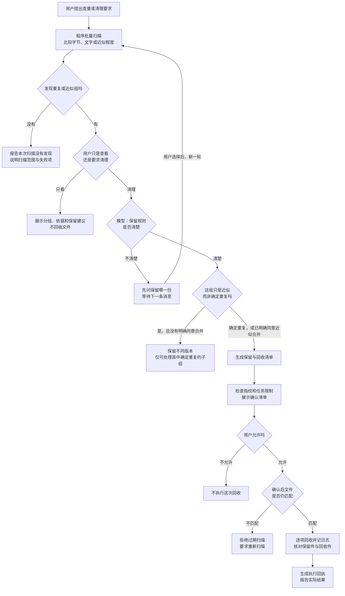
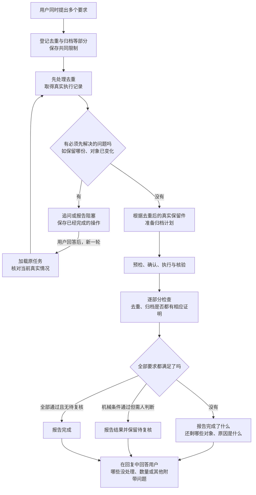
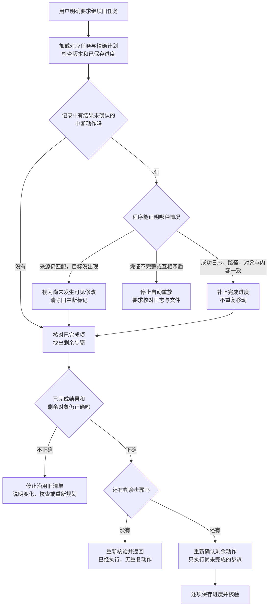
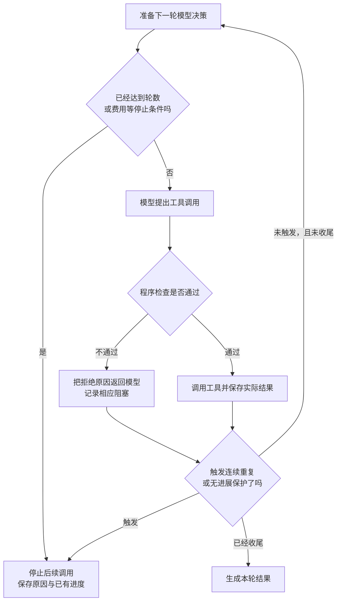
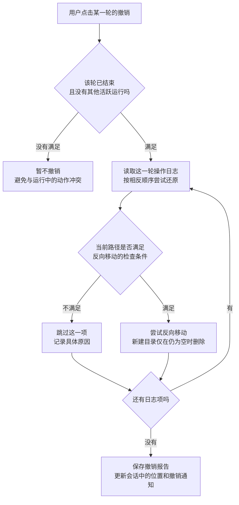

# FileButler 场景分支图：遇到什么情况，就怎样继续

读图方式：方框是一件事，菱形是一个判断，箭头上的文字表示走这条路的条件。标注“模型”的判断涉及理解与选择；标注“程序”的判断依据具体参数、文件、规则和记录。

这些图按场景归纳当前默认v3的运行方式，帮助理解。**不是程序看见某个关键词就自动进入固定流水线。**实际由模型选择工具，本地程序检查和执行；一次请求也可能组合几种场景。图中示例不代表新增实测结果。

## 目录

- [1. 总图：这次请求大致走哪里](#overview)
- [2. 找论文：找到了，还要判断是不是用户要的](#search)
- [3. 论文分类：先给方案，还是实际移动](#classify)
- [4. 移动文件：同名、拒绝、文件变化分别怎么走](#move)
- [5. 去重：完全重复与近似版本分开处理](#dedup)
- [6. 组合任务：先去重，再归档，还要回答问题](#combined)
- [7. 出错续做：确定没做、确定做了、无法确定](#recover)
- [8. 公共分支：什么时候停止，什么时候可以撤销](#stop)

## 1. 总图：这次请求大致走哪里

"提问并给具体选项"应当调用 `ask_user`，网页上会出现选择卡片。已知问题（2026-10-24 用户日志）：模型有时把选项直接写在回复正文里，这一轮被当成普通回答结束，没有卡片，用户的选择也没有本地记录。修复方案待定，见 HANDOFF 第 8 节。

只读工具可以在登记任务之前使用。上图底部的任务核验用于已经登记的任务；没有登记任务的普通回答不强行经过这一套条件。模型也可能在操作中途才发现问题并追问，先前完成的操作不会因此自动撤销。

## 2. 找论文或文件内容：找到了，还要判断是不是用户要的

**例子：**“找几篇真正使用强化学习做推荐的论文。”

关键区别：**搜到某个词，不等于论文真的使用了该方法。**检索看全文，但 BM25 不翻译查询，中文查询找不到英文论文；OCR 识别的文字可能有错字；多给几个候选也不能保证找全。

敏感文件检测默认关闭（2026-10-24）：资料库里的文件都正常读取。打开 `sensitive_files` 后，候选是敏感文件且未授权时，片段会被隐去，要先向用户请求授权；授权只在当前任务内有效。

## 3. 论文分类：先给方案，还是实际移动

**例子：**“按研究方法分类这46篇论文，证据不足的标出来。”

46篇按每批16篇，需要取得三批卡片。程序能检查“46篇是否都有分类”，却不能据此证明“每篇类别都分对”。**交付卡片也不等于模型一定读懂。**

## 4. 移动文件：同名、拒绝、文件变化分别怎么走

**例子：**“把收件箱的甲、乙两份PDF移到论文目录，重名先问我。”

如果用户选“替换”，实际是**先把旧件移入回收区，再放入新件**。准备清单只保存方案，不执行其中的业务文件修改。清单通过，只证明清单符合已登记规则；模型漏理解的要求仍可能遗漏。

## 5. 去重：完全重复与近似版本分开处理

**例子：**“这些论文去重，保留我指定的那份，近似版本先别动。”

这一场景使用专门的去重批处理。**扫描编号只在当前运行内有效**；追问后进入新一轮，不能把旧扫描编号当作仍可执行，通常要重新扫描。近似大组中的确定重复子组，是已经证实相同的小组，不能把整个近似组都当作可自动回收。

## 6. 组合任务：先去重，再归档，还要回答问题

**例子：**“先去重，再把保留的论文归档，最后告诉我哪些没有处理。”

这是按该用户请求安排的例子，不表示程序给所有复合任务写死了同一顺序。**完成一个工具调用，不等于多个要求都完成。**模型附带要告诉用户的内容可以放进最终回复，不必为每句汇报额外登记一个回答目标。

## 7. 出错续做：确定没做、确定做了、无法确定

**例子：**“甲已经移动，乙还没移，程序中途退出了；现在继续。”

图聚焦移动动作。新建目录没有移动来源可以核对，不能照搬全部恢复判断。用户改了任务要求时，还要处理版本差异；已部分执行的旧版本计划不能直接套到新要求上。服务重启也不会自动恢复整轮模型循环。

## 8. 公共分支：什么时候停止，什么时候可以撤销

### 运行保护

这是保护机制的简图，不表示检查精确到每个文件都能硬性封顶。费用在调用之间检查，是软上限；连续重复与无进展保护也不能发现所有长循环。停止不会自动把已经移动的文件搬回去。

### 用户点击撤销

撤销可能只成功一部分。它当前没有通用计划执行器同样完整的对象与原子禁止覆盖检查，不能保证任意外部变化后都安全恢复；一个跨多轮的任务，也可能对应多份需要分别处理的日志。

## 对照代码时看哪里

- 模型与工具来回循环：[agent/loop.py](agent/loop.py)。
- 登记、提问、修订和收尾：[agent/task_runtime.py](agent/task_runtime.py)、[agent/intent.py](agent/intent.py)。
- 计划、确认、执行、部分恢复：[agent/file_plans.py](agent/file_plans.py)。
- 任务与结果核验：[agent/task.py](agent/task.py)、[agent/verifier.py](agent/verifier.py)。
- 检索、分类与去重：[tools/retrieval.py](tools/retrieval.py)、[tools/classification.py](tools/classification.py)、[tools/dedup.py](tools/dedup.py)。
- 专用回收批次与操作日志：[tools/registry.py](tools/registry.py)、[safety/oplog.py](safety/oplog.py)。
- 网页确认、运行与撤销入口：[webapp.py](webapp.py)。

详细说明见[项目说明文档](项目说明文档.md)；本文是独立的场景读图材料。
