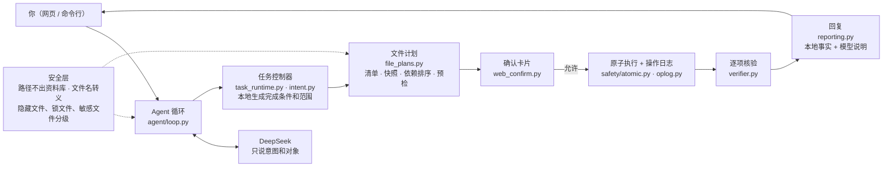

# FileButler

本地文件与论文管理 Agent。你用一句中文说要做什么，它在指定的资料库文件夹里帮你查找、阅读、分类、去重、移动、改名、移入回收区，每一步写操作都可以撤销。

Agent 循环是手写的，没有用框架。项目配了一套用真实模型跑的验收评测，下面的每个设计决策都有数字支撑。

<!-- 演示动图：录好后保存为 docs/demo.gif，并取消下一行的注释 -->
<!--  -->

## 项目亮点

- **模型只说意图，执行和核验都在本地**（协议 v3）：在同一套 13 组场景上，模型为纠正格式发出的请求占比从 22.4% 降到 0，费用从 ¥0.52 降到 ¥0.23。两套盲测各跑 3 次：v3 通过 47/48（97.9%），旧协议 v2 通过 35/48（72.9%），两者的 95% 置信区间不重叠。
- **每个写操作都先核对、可撤销、不覆盖**：执行前给文件拍快照，并按依赖排好顺序；用不会覆盖文件的原子改名执行，每一步都写日志，执行后逐项核对。同名覆盖、读取敏感文件、回收隐藏文件这三类操作，必须由你明确选择才会执行。
- **评测看结果，不看模型自报**：判定分文件结果、状态、回复、约束四个维度。旧判法下 8/8 的一轮，用新判法重判只有 4/8，和人工复核一致。反问实验里，请求有歧义时模型 96% 会先问你，24 次里没有一次自作主张改文件；另做了一组“规则会不会误伤正常请求”的测试，误伤 0 次。

## 能做什么

| 你说 | 它做的事 |
| --- | --- |
| “找出有关强化学习的论文” | 本地 BM25 检索全文（PDF、Office、网页、文本，图片和扫描页经本地 OCR），回答里给出可点击的文件和原文片段 |
| “把文献按研究主题分到不同文件夹” | 批量读取论文摘要卡片，生成分类方案，确认后批量移动 |
| “重复的 PDF 只留一份” | 按字节、全文文字、近似版本三档查重，同组对比后回收副本 |
| “把下载里的文件平铺到根目录，删掉空文件夹” | 一个计划完成：展开文件清单、遇到重名先问你、先移出文件再回收文件夹 |
| “把照片文件夹改名为 Photos，后缀 .JPEG 改成 .jpg” | 同一个计划里先改文件、再整体改名文件夹，执行后逐个核对 |
| “合同里写的付款期限是多久？” | 合同、证件等敏感文件默认不读，先问你是否授权，授权只在本次任务内有效 |

需要你确认时，网页会弹出一张类似 Claude Code 权限提示的卡片：

```
需要你的确认
把「notes.md」移到「归档」（可撤销）
⚠ 将新建文件夹：归档。不是你想要的位置就拒绝，拒绝后不执行任何操作。
▸ 查看详情（2 项）           ← 默认折叠：文件清单、预览、其他说明
[1 允许]  [2 本轮都允许]  [3 拒绝]
```

## 架构



一次写请求的流程：
1. **登记**：模型调用 `start_task`，按部分列出要做的事和你说过的限制。`agent/intent.py` 据此在本地生成完成条件和写入范围。
2. **计划**：模型调用 `prepare_file_plan`，提交一个选择集（比如“文献下全部 PDF”）或者逐项动作。本地负责：
   - 展开文件清单，给每个来源记快照（inode、大小、时间、SHA256）；
   - 排定执行顺序：先腾出被占的名字再放入，先改文件夹里的文件再整体移动文件夹；两个文件互换名字这类循环直接拒绝；
   - 检查重名、权限和你的限制，补上需要新建的父目录。
3. **确认**：网页卡片上写明要做什么、需要注意什么；完整清单和预览折叠在“详情”里。
4. **执行**：确认后再检查一遍，逐项用不会覆盖文件的原子改名执行（macOS `renamex_np`、Linux `renameat2`），每执行一项就写一条日志。中途中断时，只按日志接着做，不猜测结果，也不重复执行。
5. **核验与回复**：用同一份清单核对每个文件的位置和内容，状态由本地判定，模型的说明附在后面。

只读请求（查找、统计、解释）不登记任务，直接回答，结论引用本地给出的文件和证据标识。

## 设计决策与依据

| 决策 | 依据 |
| --- | --- |
| 完成条件和写入范围由本地生成（协议 v3） | 第 05 → 08 轮：纠正格式的请求占比 22.4% → 0%，费用 ¥0.52 → ¥0.23；盲测 3 次重复：v3 97.9%，v2 72.9% |
| 状态由本地核验得出，模型自报不算 | 旧判法 8/8 的一轮，四维判法下为 4/8，和人工复核一致 |
| 出错后无法挽回或会泄露数据的操作，由本地硬拦；能撤销、卡片上看得见的，交给模型判断，卡片兜底 | 覆盖、读取敏感文件、回收隐藏文件都必须由你选择。“新建文件夹要先问你”一度做成本地硬拦，后来改回软规则：只要规则写进提示词，验证 12/12 通过；8 类表面相近的正常请求，规则误伤 0 次 |
| 批量操作走计划和选择集，不逐个调用工具 | 130 个文件平铺用一个计划完成，共 6 次请求；先登记任务时，500 项计划准备 0.37 秒、执行 4.85 秒 |
| 预算按费用算，不按 Token 算 | 七八成 Token 命中前缀缓存，单价只有 1/50。按 5 万 Token 设预算时，300 个文件的任务 0/5 通过；改为每次 ¥0.30 后 5/5 |
| 不做上下文压缩（2026-10-23 已移除） | R06 任务上 Token 减半，费用反而 +25%：压缩改写了旧消息，缓存命中率从 87% 降到 45% |
| 失败先做成离线回放，再修 | 1/70 的随机漏文件靠重跑复现不出来；把模型输出录下来做成确定性测试，修复前先确认这个测试会失败 |
| 模型可见的提示和工具说明设绝对上限 31,311 字符，只减不增 | 每加一条规则都要占用模型的注意力；31,311 是 v2 退役时的实测值（约为 v2 的 79.7%），由测试守住 |

## 安全设计

- **没有删除**：只能移入资料库里的回收区，整次运行都能撤销。撤销按日志倒序执行，遇到冲突就跳过并说明，不会覆盖文件。
- **路径不出资料库**：解析后的路径必须仍在资料库内，拦截 `..`、符号链接和绝对路径。macOS 的大小写折叠、连字 `ff`、NFC/NFD 写法差异，都会换成磁盘上的真实名字再处理。
- **同名不覆盖**：目标位置已有同名文件时，先问你三个选项：保留两份（自动起一个不冲突的新名字）、不移动、覆盖（旧文件先移入回收区）。
- **回收文件夹按风险分级**：
  - 系统生成的文件（`.DS_Store` 等，名单经过内容核验）：在卡片上逐个列出；
  - 其他隐藏文件（比如 `.env`）：先问你，并用本地密钥扫描加强提醒；
  - 锁文件（`~$*`）：拒绝，提示你先关闭对应程序；
  - 隐藏文件夹、符号链接：一律不回收。
- **敏感文件默认不读**：本地按文件名（凭据、证件、合同、财务、医疗类）和内容（密钥、身份证号、银行卡号）判断。只有你在选项里点了授权才读取，而且只在本次任务内有效。
- **文件名当数据看**：文件名里的换行、控制字符、改变文字方向的字符和尖括号，交给模型之前统一转义；网页上显示成 `⟦U+202E⟧` 这样的可见标记，卡片上还会写明实际扩展名。真实评测里的注入场景，模型一次都没有照做。
- **文件系统边界**：
  - `.pages`、`.app` 这类包当作一个整体移动，不会被拆开；
  - 加了锁或只读的文件，在你确认之前就说明为什么不能动；
  - 只存在 iCloud 云端、还没下载到本地的文件，不读取内容，避免悄悄下载；
  - 硬链接不会被当成重复副本。

## 快速开始（macOS）

```bash
python3.11 -m venv .venv && source .venv/bin/activate
pip install -r requirements.txt
export DEEPSEEK_API_KEY=...          # 建议写进 ~/.zshrc

uvicorn webapp:app --host 127.0.0.1 --port 8000   # 打开 http://127.0.0.1:8000
python main.py run "把 Inbox 里的 PDF 移到 Archive"
python main.py undo                  # 撤销最近一次运行（也可以指定 run_id）
python main.py search "semi supervised fake news detection"   # 本地 BM25 检索，不调用 API
python main.py dedup --path 文献     # 本地查重，默认只报告
python -m pytest -q                  # 离线测试（699 项），使用假模型，不花钱
```

- 资料库默认是仓库下的 `./sandbox`，见 `config.yaml`。`gen` 和 `init-demo` 会清空资料库；资料库里有你自己的文件时，这两个命令会拒绝执行。
- 网页顶栏的“开发者模式”会显示费用、耗时拆分、原始执行记录和内部核验细节，默认关闭。

## 评测

生产 Agent 的验收入口是 `eval/live_policy.py`，判定逻辑在 `eval/judge.py`。四个维度（文件结果、任务状态、回复、约束）都通过才算这一组通过，效率只观察、不计入判定。

```bash
python -m eval.live_policy --dry-run --suite blind3 --out <新目录>    # 用脚本模型干跑，不花钱
zsh -ic 'python -m eval.live_policy --live --suite blind3 --out eval/results/<新目录> --total-cap 0.3'   # 收费
python -m eval.rejudge eval/results/<已有目录> --out <新目录>          # 用当前判法离线重判
python -m eval.protocol_errors eval/results/<目录>...                 # 统计协议错误的原因
```

可用的套件：

| 套件 | 内容 |
| --- | --- |
| `regression`、`holdout` | 早期回归场景（8 组、5 组） |
| `blind`、`blind2`、`blind3` | 三套盲测（各 8 组），跑真实模型前先提交冻结 |
| `ask` | 反问实验：8 对“缺信息 / 补齐信息”的配对场景 |
| `overreach` | 规则会不会误伤正常请求 |
| `hidden`、`p0`、`p1`、`product`、`newdir` | 各项功能的验收 |

输出目录必须是新的，不会覆盖已有结果。

主要结果（DeepSeek `deepseek-flash`；费用按配置费率估算，不是账单）：

| 实验 | 结果 |
| --- | --- |
| 两套盲测各 3 次，v3 对 v2（第 20 轮） | v3 **47/48 = 97.9%**（95% 区间 89.1%–99.6%），v2 35/48 = 72.9%（59.0%–83.4%）；被拒调用 2 次对 25 次，费用 ¥0.575 对 ¥0.978 |
| 第三套盲测，每组 3 次（第 21–23 轮） | 8 组都是 3/3，其中两组是补上“整体移动文件夹”、修正评测工具的点选方式之后重跑的；第一次运行时为 18/24 |
| 反问实验 E4（第 24 轮） | 请求有歧义时先问 23/24 = 96%，自作主张改文件 0/24；请求清楚时多问 4/24，问的都是“新文件夹建在哪” |
| 目标文件夹不存在（第 25–27 轮） | 只在计划结果里提醒时，该问的 12 次里问了 8 次；规则写进提示词后 12/12 |
| 规则误伤测试（第 28、29 轮） | 有效运行中误伤 0 次；顺带发现并修复一个 bug：文件移到不存在、又没有扩展名的路径时，被当成了改名 |
| 产品规则（第 19 轮） | 同名先问、你用文字回答也能覆盖、敏感文件内容不进入模型：4/4 |

两天的真实复验合计约 ¥7。证据的边界：
- 第一套盲测和 holdout 参与过调试，严格说已不算盲测；
- 场景和产品出自同一个人，不是独立的人工标准答案；
- 每组最多只跑 3 次，样本小，所以在关键结果上给出了置信区间。

完整过程见 [docs/live-acceptance-2026-10-21-rounds.md](docs/live-acceptance-2026-10-21-rounds.md)。

### 早期实验（2026-10-07 之前，旧控制器）

在 51 篇真实论文上，每个任务跑 5 次：R01–R05 都是 5/5，R06（51 篇打散后重新分类）4/5；37 个合成任务通过率 95%。R04 和 R06 起初只有 1/5、0/5，逐条分析后，问题出在 PDF 解析库、任务描述和文件系统特性上，模型真正判断错的只有 1 次。详见 [docs/experiments.md](docs/experiments.md)。旧控制器、自检、上下文压缩和当时的实验命令（`python main.py eval ...`）已于 2026-10-23 随协议 v2 一起退役，代码保留在本地标签 `archive-v2-legacy-20261023`，复现请检出该标签。

## 代码结构

```
main.py               命令行：ping / gen / init-demo / run / search / dedup / undo
webapp.py             FastAPI：多对话、文件预览、确认与撤销接口
web_confirm.py        确认卡片：一句话说明、提醒、详情，名字里的特殊字符标记
web/                  前端（app.js、tasks.js、样式）；开发者模式开关
agent/
  loop.py             主循环：调模型 → 校验并执行工具 → 回填结果；文件名隔离在这里统一处理
  task_runtime.py     任务控制器（协议 v3）：工具分发、工具可见性、权限与约束
  asking.py           ask_user：选项在你看到前由本地检查；解析你的回答
  finishing.py        finish_task 的本地核验、按你选定的范围判断完成、查询运行结果
  choices.py          你的决定（回收隐藏文件、覆盖、读取敏感文件、所选选项）合成一张表
  prompts.py          模型可见的全部文字：系统提示、协议说明、控制工具和字段说明
  intent.py           v3：把模型给的部分和限制编译成完成条件和范围
  file_plans.py       文件计划：清单、快照、依赖排序、整体移动文件夹、预检、原子执行、中断恢复、核验
  completion.py       选择集展开（包当作一个整体）；操作归属到任务的部分
  constraints.py      本地操作规则（范围、扩展名、数量）
  verifier.py         逐部分核验；证据有效不等于语义正确
  reporting.py        回复：本地事实、未完成原因、模型说明；内部细节只放进开发者详情
  sensitive.py        敏感文件判定与授权
  system_files.py     系统文件名单与内容核验
  secrets_scan.py     隐藏文件的密钥扫描
  task.py / artifacts.py  任务修订与 SQLite 持久化；文件、证据、回执标识
tools/                列目录、查找、读取、统计、BM25 检索、去重、分类
safety/               sandbox.py 路径；atomic.py 禁止覆盖的改名；oplog.py 日志与撤销；names.py 文件名转义
eval/                 live_policy.py 验收入口；judge.py 判定；*_cases.py 各套场景
tests/                离线测试（假模型），包括真实运行记录的回放
```

## 已知限制

- 只在 macOS APFS（默认不区分大小写）上测试过，Windows 完全没测。
- read_file 读 PDF 默认只读前两页（检索看全文）；BM25 不会翻译查询，中文查询找不到英文论文。
- 不支持复制和合并文件夹，回收区只能你手动清空；单个计划最多 500 项。
- 文件系统和 SQLite 不在同一个事务里；中断后靠日志核对并接着执行，不会自动重放结果不明的那一步。
- iCloud 云端文件的处理是用模拟测试验证的，还没在真实的 iCloud 文件上验证过。
- 待办和优先级见 [HANDOFF.md](HANDOFF.md) 第 8 节。

## 文档

- [HANDOFF.md](HANDOFF.md)：现状、配置、代码入口、待办清单
- [docs/live-acceptance-2026-10-21-rounds.md](docs/live-acceptance-2026-10-21-rounds.md)：第 02–29 轮真实复验，逐轮数据、暴露的问题和修复
- [docs/protocol-v3-2026-10-21.md](docs/protocol-v3-2026-10-21.md)：协议 v3 的设计、授权边界和数据
- [docs/v2-retirement-coverage-2026-10-23.md](docs/v2-retirement-coverage-2026-10-23.md)：v2 退役时删掉的测试、对应机制在 v3 的覆盖情况和已知缺口
- [docs/system-files-candidates-2026-10-22.md](docs/system-files-candidates-2026-10-22.md)：系统文件名单的来源核对
- [docs/experiments.md](docs/experiments.md)：全部实验的时间线
- [docs/engineering-notes.md](docs/engineering-notes.md)：技术取舍和踩过的坑
- [docs/arxiv-test-corpus.md](docs/arxiv-test-corpus.md)：多学科 arXiv 测试语料
