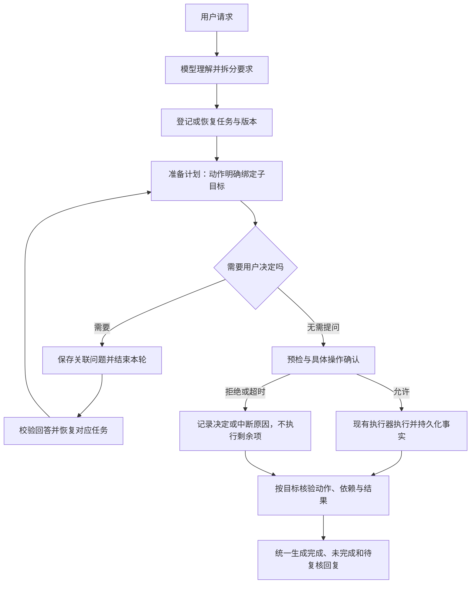

# FileButler Agent 链路优化方案

日期：2026-10-23（Asia/Taipei）  
状态（2026-10-24 更新）：方案一至三已完成，方案四、五待定。
- 方案一：`b0f17bb`、`b39323b`、`210092f`，第 33、34 轮真实复验。
- 方案二：`2636a19`、`5adc89c`，第 36 轮真实复验 6/6。另有 2 个已知缺口，以 xfail 形式记录在 `tests/test_answer_replays.py`。
- 方案三：`912b9a6`，第 35 轮真实复验。
实施细节和数字见 HANDOFF。

## 1. 目标与现状

本方案的目标是让“用户要求、任务目标、操作计划、执行事实、完成判定”之间的关系更明确，方便维护、续做和排查问题。

现有 v3 已经具备以下机制，本方案在这些机制上改进：

- 模型通过 `start_task.parts` 拆分复合请求，本地编译成任务目标和完成条件。
- 普通移动、改名、建目录、回收及分类移动统一经过 `file_plans.execute`。
- 去重回收使用专门的批量执行路径；两条路径已经共用资料库锁、约束检查、确认机制和操作日志。
- 本地逐目标核验，语义判断保留人工复核。
- 用户提问、任务修订、跨轮历史和运行结果已经持久化。

因此，本方案不是重新建立任务拆分模块或文件执行器。重点是修正目标归属，理顺问题恢复、当前状态和工具结果的交接。去重是否进一步并入普通执行器，留作后续评估，不属于本次必做项。

### 证据与边界

- 本轮阅读范围包括 HANDOFF、任务编译、主循环、控制器、计划执行、去重、分类、核验、报告、历史与 Web 续做代码。
- 本轮运行离线测试：394 passed，7 warnings；未调用付费模型。
- 已在临时目录复现目标归属问题：登记“归档 a”和“把 b 改名”两个 `organize` 目标，只准备并执行归档 a 的计划且省略 `goal_ids`，两个目标的核验都通过，b 实际未改名。
- 第一项是已复现的正确性问题。其余是代码结构与交互改进建议，不表示全部已经造成线上故障；应在实施前补充对应回放或测试。
- 测试结果是本次阅读时的基线，不代表本方案实施后的验证结果。

## 2. 方案一：准确绑定子目标、动作与完成证明

### 2.1 当前行为与问题

任务已经拆成多个部分，但多个部分具有相同完成条件时，程序可能把同一份计划同时绑定给它们。执行器正确完成一份计划，上层却把多个目标一起判为完成。

主要位置：

- `agent/intent.py`：`compile_goal`、`compile_start`。
- `agent/completion.py`：`claimed`、`attribute`。
- `agent/file_plans.py`：`_attribute_steps`、计划绑定与进度记录。
- `agent/verifier.py`：`verify_bound_plans`、`verify_task`。

### 2.2 优化后的关系

用户要求：“把 a 归档，再把 b 改名。”

| 子目标 | 对应动作 | 完成证明 |
| --- | --- | --- |
| G1：归档 a | A1：把 a 移到归档目录 | a 到达目标位置，身份与内容符合预期 |
| G2：改名 b | A2：把 b 改成指定名字 | 新名字生效，身份与内容符合预期 |

明确保存以下关系：

```text
目标 ID → 动作 ID → 持久化执行记录 → 核验结果
```

同一份计划可以包含 A1、A2，仍可一次确认、批量执行，不要求拆成独立运行或独立 Agent。

### 2.3 具体改动

第一步，修复自动归属：

- 只有一个匹配目标时允许自动归属。
- 匹配多个目标时，不按相同完成条件默认全部绑定，要求通过已有 `goal_ids` 明确指定。
- 区分“为保守检查而应用哪些约束”与“这次动作能证明哪些目标完成”。前者可以保守合并，后者不能沿用同样的全部认领逻辑。

第二步，完善多目标单计划：

- 在动作上支持明确的目标归属；计划级 `goal_ids` 表示涉及的目标集合，动作级归属表示每一步具体服务的目标。
- 自动创建的父目录归属于依赖它的动作；共享依赖可以服务多个目标。
- 保存各部分的 `scope` 供归属检查辅助使用。该字段仍是模型的范围估计，不能自动成为用户授权或新增硬性限制。
- 需要增加模型可见字段时，必须同时精简重复说明，保持现有提示与 schema 的字符上限。

第三步，调整逐目标核验：

- 目标核验读取对应动作和必要依赖的执行事实，而不是直接复用整份计划的成功标志。
- 某目标没有动作、有效回执、空选择集证明或有效的用户跳过决定，不能判为完成。
- 同计划 A1 成功、A2 失败时，可记录 G1 完成、G2 未完成，计划和整个任务仍为部分完成。
- 支持核验已经持久化且确定完成的部分进度；结果不明的 inflight 动作不能算完成。
- 保留跨计划对象接续核验，后续移动不能让先前合法操作被误判失效。
- 分类正确性、检索相关性等语义要求继续保留人工复核。

### 2.4 能解决与不能解决的问题

本项解决成功证明被错误复用和动作归属不明确的问题，不保证模型永远完整理解自然语言。模型漏掉用户要求或写错归属，仍需要场景评测与语义复核发现。

历史记录照常展示；再次核验或续做遇到旧的模糊绑定时，要求澄清归属，不能直接伪造精确映射。

### 2.5 验收标准

- 只执行归档 a，改名 b 必须未完成。
- 同一计划正确执行两项操作，两目标都通过。
- 两个同类目标省略归属，不得自动全部绑定。
- 执行中断时，各目标已完成与未完成进度准确，必要依赖必须成功。
- 空选择集、用户跳过、任务修订及跨计划接续核验保持正确。
- 既有权限、约束和语义复核标准不被削弱。

## 3. 方案二：用户回答后明确恢复对应任务

### 3.1 当前行为与问题

网页选项按钮当前发送“A”“B”等普通文字。后台根据最近的问题解释回答，后续仍由模型结合历史决定如何继续。问题与任务、版本、受影响部分之间需要更明确的关联。

主要位置：`agent/asking.py`、`agent/task_runtime.py`、`agent/choices.py`、`agent/task.py`、`webapp.py`、`web/app.js`。

### 3.2 问题记录

| 信息 | 用途 |
| --- | --- |
| 问题 ID | 确定回答的是哪一道问题 |
| 任务 ID、任务版本 | 恢复任务并检查过期状态；登记前的问题允许暂时没有任务 ID |
| 涉及的子目标 | 限定选择影响哪些部分；不明确时不得自动排除其他目标 |
| 选项与声明动作 | 保存用户实际看到和选择的内容 |
| 状态及回答记录 | 防止旧选项或重复请求被再次消费 |

问题记录需要持久化，不能只存在于网页内存中。可在现有 TaskStore 中增加专门记录，任务和运行结果保存其引用，避免维护多份互相冲突的问题状态。

### 3.3 具体流程

```text
发现 b 重名
    ↓
保存问题：关联任务 T、第 2 版、子目标 G2
    ↓
用户提交问题 ID 与“保留两份”选项
    ↓
校验会话、问题状态和任务版本
    ↓
恢复任务 T、既有进度和累计预算
    ↓
记录选择，继续处理 G2
```

- 网页按钮提交结构化答案，界面继续显示普通中文。
- 问题回答以原子状态更新方式消费，重复点击不能重复生效。
- 问题过期时停止沿用该选项，重新呈现当前需要决定的内容。
- 尚未登记任务就提问的场景，回答后将决定交给随后登记的对应任务，不能假设所有问题都有旧任务可恢复。
- 恢复任务不等于自动执行，仍需现有预检与具体操作确认。
- CLI 的单字母回答保留兼容，但只绑定当前有效的待回答问题。

### 3.4 自由文本与授权

自由文本可能是补充、更正或新请求，由模型判断，通过现有续做和修订入口明确表达，不靠关键词路由。

- 新请求不能自动继承上一问的选项与授权。
- 敏感读取继续要求明确点选授权。
- 文字同意覆盖、隐藏文件回收，继续保留具体确认卡片兜底的既有规则。
- “跳过 b”只影响问题涉及的部分，不能把其他未处理目标一起排除。
- 不因恢复任务而重置累计检索、阅读预算或执行账本。

### 3.5 验收标准

- a 已完成，回答 b 的问题后不重复处理 a。
- 旧问题、重复点击、外会话问题与过期版本不能直接生效。
- 提问后发送新请求，不沿用旧选择。
- 跳过 b 不影响其他目标。
- 登记前提问、重启后恢复、CLI 回答均有覆盖。
- 重启后恢复记录仍需重新核对真实文件状态。

## 4. 方案三：每轮只注入一份最新任务状态

### 4.1 当前行为与问题

`agent/loop.py` 每轮追加协议说明与动态任务状态；Web 又将新增消息保存回历史。`agent/history.py` 主要归档旧工具交换，旧的 v3 动态说明可能继续累积。

模型可能同时看到“之前未完成”“之前等待选择”“现在已完成”等多个状态快照。

### 4.2 优化后的上下文

```text
一份固定规则
必要历史对话、工具记录与撤销事件
一份从持久化记录生成的最新任务快照
当前用户输入
```

### 4.3 具体改动

将信息明确分成三类：

- 固定规则：工具协议与安全边界，保持稳定。
- 历史事件：用户原话、工具结果、实际撤销记录，继续保留。
- 当前快照：任务版本、目标进度、待回答问题、有效决定与预算，每轮重新生成。

当前快照属于请求投影，不作为普通聊天消息反复累积。可单独留审计记录，但不让其每轮重新进入模型历史。

迁移旧对话时，只过滤能明确识别为程序生成的旧快照，不删除用户指令、撤销通知或执行记录。

修改 Web 的保存接口，让循环明确返回“本轮新增消息”。不能继续依赖历史列表长度切片，因为过滤后列表位置会改变。

内部记录类型标记与模型 API 消息分开：发送给模型的仍是标准消息字段，不把内部元数据直接传给 API。

主要位置：`agent/history.py`、`agent/loop.py`、`agent/task_runtime.py` 的 guidance 生成、`webapp.py` 的历史保存。

### 4.4 验收标准

- 连续十轮对话，每次请求只有一份当前任务快照。
- 用户限制、有效决定与撤销事件保留。
- 工具调用与结果成对，失败中止时也不产生悬空消息。
- 不把历史位置当作当前状态，实际核验仍以文件系统与持久化事实为准。
- 模型可见提示与工具定义继续满足现有 31,311 字符上限。
- 记录历史与动态快照的体积变化；费用和成功率收益必须测量后再下结论。

## 5. 方案四：结构化交回工具结果，控制器统一登记

### 5.1 当前行为与问题

现有 `ToolResult` 已包含状态、文字、错误码与重试信息，但大部分业务信息仍放在文字中。控制器还通过 artifact 增量、操作日志及工具对运行时状态的修改收集结果。

主要位置：`tools/registry.py`、`agent/task_runtime.py` 的 `after`、`tools/findings.py`、`agent/reporting.py`、`agent/loop.py`。

### 5.2 建议的数据交接

扩展现有 ToolResult，而不是再建立另一套结果体系：

| 字段 | 内容 |
| --- | --- |
| status、text | 保留现有调用状态和简短说明 |
| data | 统计、文件信息等结构化结果 |
| references | 证据、分类方案、计划等引用 |
| operation_refs | 已持久化的执行记录引用 |
| display | 本地生成的表格、清单或展示信息 |
| error_code、retryable | 明确失败类型与是否可重试 |

这是内部结果设计，不要求把全部数据重复发送给模型。

### 5.3 职责划分与迁移

- 工具产出结果并交回引用。
- 执行器持久化真实操作事实；工具不能通过返回文字自行证明写入成功。
- 控制器统一检查和登记结果。
- 核验器根据持久化事实判定目标是否满足。
- 报告模块生成面向用户的主回复和详情。

失败结果可以带已完成记录，例如“第二项失败，第一项已执行并记日志”。不因整体返回 error 丢掉部分进度。

先迁移通过修改 `runtime.final_answer` 传递业务结果的工具，例如 `report_findings`；再迁移其他工具。旧字符串返回保留一个集中兼容适配器，避免一次性重写全部工具。

完整内部结果、模型必要摘要、用户展示分别投影，避免增加模型上下文和重复表格。

### 5.4 验收标准

- 部分失败仍准确呈现已完成操作。
- 迁移后的工具不通过设置 `runtime.final_answer` 交回业务结果。
- 操作引用对应真实持久化记录，不能由模型文字伪造。
- UI 通知失败不打断已授权操作。
- 只读结果、写操作回执、模型解释在报告中来源明确。
- 同一份结果不因多次收集而重复登记或展示。

## 6. 方案五：记录拒绝的具体操作，阻止等价重复提交

### 6.1 当前行为与问题

当前确认可以阻止本次执行，但重复调用检测主要比较工具名与参数。换计划 ID 或描述后，同一份操作可能不再被视为相同调用。

本项需要先补对应回放，区分“现有保护已经拦住的情况”与“确实会重复弹窗的情况”。

主要位置：`safety/confirm.py`、`agent/file_plans.py` 的 `_confirm`、`agent/task.py`、`agent/repetition.py`，以及 Web 确认等待流程。

### 6.2 区分确认结果

确认结果需要区分：允许、本轮都允许、明确拒绝、等待超时或连接结束。

保留旧 `allow()` 布尔接口的兼容能力，但增加内部结构化结果，明确记录来源。超时或 EOF 不能伪装成用户明确拒绝，也不能自动重试造成连续弹窗。

### 6.3 比较实际操作，而非计划编号

给规范化后的操作清单生成比较指纹：

- 包含对象、操作类型、实际目标，以及覆盖、隐藏文件等实际影响。
- 排除随机计划 ID、描述文案和无业务意义的生成值。
- 对自动生成的回收位置，按回收对象和动作比较，不能因随机回收路径变化就视为新方案。
- 不依据自然语言相似度判断是否为同一方案。
- 文件变化要求重新预检，但不能自动清除用户拒绝。

明确拒绝后，在当前任务中保存操作指纹、清单摘要、任务上下文和拒绝来源。执行前比较是否为已拒绝的等价清单。

命中时返回明确原因，交由模型说明停止或提出实质不同的方案，不再弹出相同确认。

### 6.4 重新确认的规则

- 用户明确要求重试，可以重新进入确认流程。
- 方案实质变化，可以展示差异并重新确认；实质变化不等于自动获得权限。
- 仅改变计划编号、描述、任务版本，不自动清除拒绝。
- 拒绝整份计划不等于永久禁止它的所有子集；缩小范围等新方案应按实际差异判断。
- 已执行操作保留，拒绝只阻止未执行部分，不自动撤销。
- 继续支持“本轮都允许”的现有产品语义，不在本项中擅自改成其他授权范围。

### 6.5 验收标准

- 同计划重试不重复弹窗。
- 新 ID、相同操作仍能识别。
- 实质不同方案可正常确认，正常请求不被误伤。
- 用户明确要求重试后可重新询问。
- 超时与明确拒绝分别记录。
- 部分执行后拒绝，已完成与剩余范围准确。
- 跨轮恢复后拒绝记录仍有效，不因任务版本或模型措辞改变而自动丢失。

## 7. 实施批次与验证方式

| 批次 | 改动范围 | 完成标准 |
| --- | --- | --- |
| 第一批 | 修复目标自动归属 | “只做 a，两个目标都通过”的复现不再成立 |
| 第二批 | 动作级归属与逐目标核验 | 同计划多目标可以分别对账，中断进度准确 |
| 第三批 | 问题关联、回答消费与任务恢复 | 旧问题、新请求和续做不混淆 |
| 第四批 | 当前快照与结构化工具结果，分小步提交 | 每轮一份最新状态，结果交接来源明确 |
| 第五批 | 拒绝记录与等价清单比较 | 相同操作不重复提交，正常新方案不受误伤 |

验证流程：

1. 先把已复现问题固定为离线回放，确认修复前失败。
2. 对结构改动先补当前行为测试，再补预期行为与反向用例。
3. 每批修改后运行相关测试与完整离线回归，不一次性修改所有模块。
4. Web 按钮、过期问题、确认超时、拒绝后的行为需要 HTTP 测试，并补真实浏览器验收。
5. 涉及模型行为的收益，例如少问、少重试、费用下降，需要后续真实模型验证；不得用离线测试结果替代该结论。
6. 真实模型验证需另行报费用估算并取得授权，使用新结果目录，不覆盖已有证据。

不扩大权限，不弱化完成条件，不自动重放结果不明的写入，不把模型估计范围当作用户限制，不取消语义复核。

## 8. 优化后的整体链路



上图描述需要执行文件操作的任务。纯解释和讨论保持轻量；只读工具可在登记前获取事实。需要语义判断的结果继续保留复核。具体工具顺序由任务和模型决定，不按关键词写死业务路由。

每一步的职责明确为：模型理解与选择；任务控制器保存目标、决定和进度；执行器完成操作并留下事实；核验器逐目标检查；报告模块面向用户表达结果。
